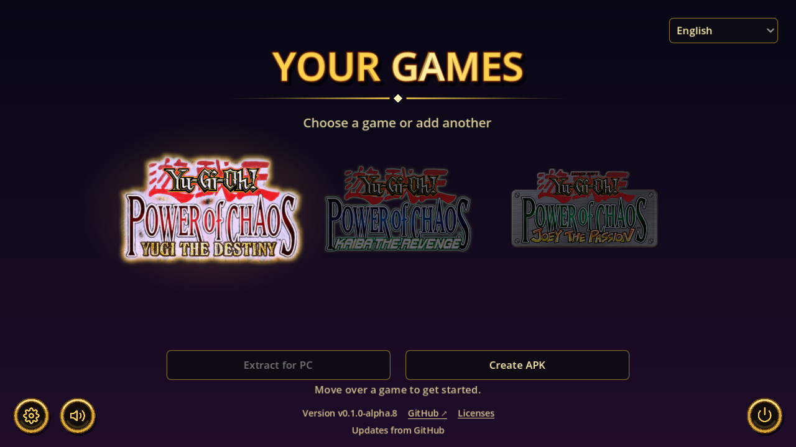
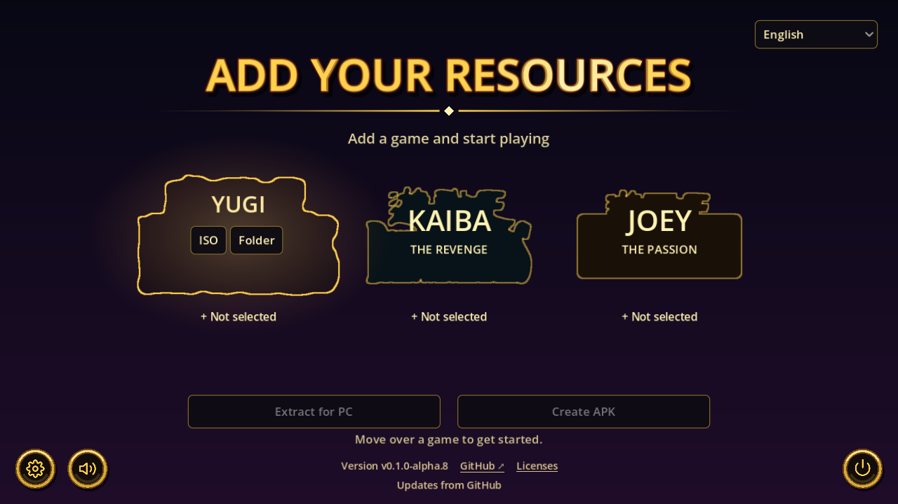

<p align="center">
  
</p>

# Yu-Gi-Oh! Power of Chaos Remake

[English](README.md) | **Español**

## Tus ISO → PC o APK para Android

Selecciona los ISO o las carpetas instaladas de tus juegos y elige:

- **Extraer para PC** para preparar los juegos en Windows.
- **Crear APK** para generar un APK con los controles táctiles, el scroll y el arrastre de la rama Android. El APK y su informe de validación quedan en **`PoC Data/android/apks/`**. También puedes reutilizar los juegos ya preparados.

**Android se prepara desde el launcher.** La primera vez que pulses **Crear APK**, acepta la licencia del SDK y el launcher descargará, verificará y configurará las herramientas oficiales automáticamente. No necesitas instalar Python, Android Studio, Java ni configurar rutas. Todo queda dentro de **`PoC Data/android/`** y se reutiliza en las siguientes compilaciones. [Crear tu APK](#crear-tu-apk-android).

Tus ISO y recursos convertidos permanecen en tu equipo; la descarga no incluye datos originales del juego. La conexión de Joey ya se probó entre **PC y PC**, y entre **PC y Android**. El proyecto continúa en alfa: agradecemos comentarios, errores y pruebas con otras ediciones y equipos.

**Tus juegos de Power of Chaos reunidos en un launcher moderno para Windows.**

## Ventajas

- **Extraer para PC o crear un APK desde el mismo launcher.** Reutiliza tus juegos compatibles y elige el destino; el launcher prepara las herramientas Android automáticamente.
- **Duelos en red en Joey sin DirectPlay.** La conexión moderna por red local sustituye ese componente antiguo de Windows. Conexión probada entre PC y PC, y entre PC y Android.
- **Portable.** Lleva juntos el EXE y su carpeta **`PoC Data`**: ahí viajan tus recursos, partidas y ajustes.
- **Recursos más livianos.** Las imágenes WebP sin pérdida y el audio OGG reducen el espacio ocupado. La biblioteca de Yugi probada ocupa aproximadamente **un 44% menos** que su versión convertida sin comprimir. El ahorro depende del juego y la edición.
- **Decoraciones para 16:9.** Los laterales decorados rodean el área de duelo original de 4:3 en las vistas compatibles de Yugi, Kaiba y Joey, cada uno con su propio fondo.
- **Todo en uno.** Yugi the Destiny, Kaiba the Revenge y Joey the Passion comparten un launcher. Puedes empezar con uno y añadir los demás cuando quieras.
- **Renderizado a 60 FPS y más, según la pantalla.** El renderizado sigue la frecuencia de la pantalla e interpola entre los pasos originales del juego a 30 Hz. Los FPS efectivos dependen del equipo y la pantalla; se conserva la velocidad original de juego.

## Capturas del launcher

**Biblioteca con los tres juegos preparados (interfaz en inglés)**



**Importa tus recursos y elige extraer para PC o crear un APK Android**



Las capturas muestran el launcher Windows. Los logos aparecen después de importar tus propias copias compatibles.

## ¿Qué es este remake?

Yu-Gi-Oh! Power of Chaos Remake es una reconstrucción experimental en Godot del motor de **Yugi the Destiny, Kaiba the Revenge y Joey the Passion**. Busca conservar las reglas, la presentación y la sensación de los originales, facilitando su uso y mantenimiento en PC modernos.

Tú aportas una copia compatible del juego que quieras usar. El launcher lee sus recursos en tu equipo y los prepara para el nuevo motor. **Basta con un juego para empezar.**

> **Versión preliminar:** el desarrollo y las pruebas de compatibilidad continúan. Todavía no es un reemplazo terminado y completamente fiel de todas las ediciones originales.

### Más funciones del launcher

- **Un solo EXE para Windows.** Incluye Godot, el conversor y 7-Zip; no necesitas instalarlos por separado.
- **Importación desde ISO o carpeta instalada.** Las imágenes compatibles se leen sin ejecutar sus instaladores ni los juegos originales.
- **Archivos locales.** Tus ISO, recursos y partidas no se suben a GitHub ni a un servicio de conversión.
- **Añade juegos sin empezar de nuevo.** Las importaciones posteriores conservan los juegos preparados y los guardados del remake.
- **Selector de idiomas.** Inglés, español, alemán, francés, italiano y japonés; el primer inicio toma un idioma compatible del sistema y recuerda tu elección.
- **Menú propio.** Música del launcher, controles dorados, icono propio y ajuste de volumen.
- **Motor en Godot.** Los recursos originales los aporta cada jugador por separado.

«Remake» se refiere a la reconstrucción del motor. No significa que se hayan redibujado las cartas ni vuelto a grabar las voces y la música originales.

## Empezar en Windows

1. Descarga **`PowerOfChaos.exe`** desde [Releases](https://github.com/Johanfer12/Yu-Gi-Oh-Power-of-Chaos-Remake/releases). También hay compilaciones de desarrollo en [Actions](https://github.com/Johanfer12/Yu-Gi-Oh-Power-of-Chaos-Remake/actions/workflows/build-windows.yml).
2. Pon el EXE en una carpeta donde quieras guardar el launcher y tus partidas, y ábrelo.
3. En **SUBE TUS RECURSOS**, pasa el cursor por el juego que quieras añadir y elige **ISO** o **Carpeta**.
4. Selecciona una imagen de disco o carpeta instalada compatible, pulsa **Extraer para PC** y espera a que termine.
5. Haz clic en el logo del juego preparado para jugar. Puedes añadir los otros después.

La descarga es un único EXE, sin asistente de instalación. La primera importación prepara las herramientas incluidas en `PoC Data/tools/`; abrir el menú no espera esa extracción. Los archivos de Actions pueden venir en ZIP; los de Releases permiten descargar directamente el EXE.

Necesitas Windows con soporte para el renderizador OpenGL de compatibilidad de Godot, una copia compatible de al menos un juego y espacio libre para los recursos y archivos temporales. Una carpeta instalada debe contener `Data.dat`, `Voice.dat`, `Region.dat` y el ejecutable original correspondiente; este se lee para obtener tablas del motor, sin ejecutarlo.

## Cómo funciona

```text
Tu ISO o carpeta instalada
            |
 Validación y extracción local
            |
 Recursos convertidos en tu PC
            |
     Motor del juego en Godot
```

El EXE distribuido contiene el launcher, el motor y las herramientas de conversión. No incluye los ejecutables originales ni sus ilustraciones, voces o música de juego: se obtienen de la copia que selecciones.

La conversión valida y comprime una biblioteca temporal dentro de `PoC Data` antes de activarla en `PoC Data/resources/`. Al añadir un juego se conservan los ya importados. Tras completar el cambio se retira la copia generada anterior; tus ISO, carpetas originales y guardados no se sobrescriben. El importador rechaza revisiones no compatibles e imágenes dañadas o incompletas; no descarga recursos faltantes.

### Dónde queda cada archivo

| Archivos | Ubicación junto al EXE |
| --- | --- |
| Recursos WebP/OGG y datos del motor | `PoC Data/resources/` |
| Guardados del remake | `PoC Data/saves/` |
| Ajustes | `PoC Data/content.cfg` |
| Herramientas y licencias | `PoC Data/tools/` |
| Extracción temporal | `PoC Data/temp/` y carpetas transitorias dentro de `PoC Data/` |
| Último error de importación | `PoC Data/import-last-error.log` |

Si falla una importación, el launcher muestra el juego afectado, el archivo o carpeta, la etapa y la causa. La ventana permite **Copiar detalles** y **Abrir registro**; **Ver error** la vuelve a abrir. Un fallo general de conversión, compresión o escritura se identifica por su etapa y no se atribuye a una ISO sin evidencia.

**Mueve o respalda juntos `PowerOfChaos.exe` y `PoC Data`.** Las rutas relativas permiten cambiar de carpeta o unidad sin volver a importar. Usa una carpeta con permiso de escritura.

El launcher busca versiones en GitHub al abrirse. El botón circular de **actualizar**, junto al de encendido, sólo aparece cuando se detecta una versión más nueva. El pie muestra tu versión, el estado y vínculos a GitHub y licencias. Puedes descargar una nueva versión y reiniciar desde el launcher: se verifica su SHA-256 y se reemplaza únicamente el EXE, conservando `PoC Data`. La descarga se puede cancelar. Si falla el reemplazo o el inicio del nuevo proceso, se intenta restaurar el EXE anterior; el diagnóstico queda en `PoC Data/updates/last-update.log`. Las versiones alpha/beta también reciben preliminares; las estables siguen el canal estable. Requiere Windows, conexión y permiso de escritura en la carpeta del EXE.

Al actualizar en la misma carpeta se copian los antiguos `saves/` adyacentes sin reemplazar guardados portables más recientes. También se migran los ajustes anteriores y se prepara una copia compacta de la biblioteca importada. Se mantiene la fuente antigua hasta verificar la nueva. Si cambias de carpeta, lleva el antiguo `saves/` junto al nuevo EXE antes de abrirlo por primera vez, o mueve tu `PoC Data` existente.

## Compatibilidad y límites actuales

Esta versión pública está orientada a **Windows PC**.

| Juego | Importaciones comprobadas | Comprobaciones del motor |
| --- | --- | --- |
| Yugi the Destiny | ISO y carpeta compatibles | Inicio independiente del título y duelo normal |
| Kaiba the Revenge | ISO y carpeta compatibles | Inicio independiente del título y duelo normal; perfiles compatibles sin necesitar Yugi |
| Joey the Passion | ISO y carpeta compatibles | Inicio independiente del título y duelo normal |

Se han importado ISO compatibles de los tres juegos; las imágenes truncadas se rechazan con detalles del juego afectado. La compatibilidad con otras revisiones y regiones sigue ampliándose.

Las reglas, la IA, la presentación y los tiempos siguen comparándose con los originales. Estas pruebas no certifican todos los duelos ni todas las cartas. Al informar de un fallo, indica juego, edición, origen de importación y pasos para reproducirlo; no adjuntes archivos originales del juego.

Los discos MSI/CAB compatibles se extraen con el 7-Zip incluido. Los medios Inno Setup requieren `innoextract` en `PATH`; para otros instaladores, instala tu copia por separado y selecciona su carpeta.

## Idiomas y voces

El selector controla el launcher y los textos disponibles del juego. La disponibilidad depende de la edición importada. `Data.dat` puede variar entre regiones y revisiones.

Los doblajes se detectan desde `Voice.dat`. Al cambiar de idioma se usa el doblaje correspondiente si está importado; de lo contrario, se conserva el principal. El selector no descarga voces.

Puedes añadir voces de otra copia compatible del mismo juego mediante las herramientas de código fuente:

```powershell
python -m pocx.import_games --base "datos-existentes" --voice "joey=C:\Mi copia de Joey\Voice.dat" --out "datos-nuevos"
```

Usa una carpeta de salida nueva para importaciones manuales. El launcher gestiona sus propias actualizaciones. Dos doblajes distintos del mismo juego e idioma se rechazan como conflicto.

## Ejecutar desde el código fuente

Requiere **Godot 4.7.2** y **Python 3.12 o posterior**. La compilación automática usa Python 3.13.

```powershell
git clone https://github.com/Johanfer12/Yu-Gi-Oh-Power-of-Chaos-Remake.git
cd Yu-Gi-Oh-Power-of-Chaos-Remake
python -m pip install ./tools
godot --editor --path game
```

Ejecuta `game/project.godot` desde el editor e importa tus recursos. Si usas un entorno virtual de Python, abre Godot desde una consola con ese entorno activado. Las importaciones desde el código necesitan 7-Zip instalado en su ubicación habitual de Windows o disponible en `PATH`. El EXE publicado ya incluye las herramientas y el codificador de audio; no necesita FFmpeg.

Pruebas del importador con datos sintéticos, sin recursos originales:

```powershell
$env:PYTHONPATH = "tools"
python -m unittest discover -s tools/tests -p "test_*import.py" -v
```

## Compilaciones automáticas

El flujo [Launcher Windows](https://github.com/Johanfer12/Yu-Gi-Oh-Power-of-Chaos-Remake/actions/workflows/build-windows.yml) genera una compilación con cada cambio en `main` y cada solicitud de cambios; también puede iniciarse manualmente. Las etiquetas que empiezan por `v` publican una versión preliminar con EXE, suma SHA-256 y manifiesto de compilación.

Cada compilación comprueba la política de archivos, ejecuta las pruebas sintéticas, crea una exportación limpia y verifica el conversor incluido. No necesita ni incorpora recursos originales. Las copias instaladas pueden buscar y descargar versiones desde el botón de actualizar; el reemplazo y reinicio requieren confirmar la actualización.

## Estado del proyecto y avisos

Este es un proyecto independiente y no oficial, sin afiliación ni respaldo de los editores o titulares de los juegos originales. Los nombres identifican los títulos compatibles; los recursos y marcas pertenecen a sus respectivos titulares.

El tema musical del launcher, sus tres fondos externos de duelo y el icono propio pertenecen a este proyecto. Los marcos de juegos pendientes incluyen contornos vectoriales derivados de los logos originales; sus imágenes se cargan únicamente tras importar la copia del usuario.

El código incluye trabajo derivado de ingeniería inversa. Su procedencia y la licencia general siguen en revisión; no se ha asignado una licencia global al repositorio. Publicar estas fuentes no otorga derechos para redistribuir los recursos originales.

Cada componente de terceros conserva su licencia. Consulta [THIRD_PARTY_NOTICES.md](THIRD_PARTY_NOTICES.md) y **Licencias** en el launcher, incluidas las fuentes correspondientes de 7-Zip.

## Crear tu APK Android

1. Selecciona tus ISO/carpetas o reutiliza la biblioteca preparada para PC.
2. Pulsa **Crear APK**. En la primera preparación, el launcher ofrece leer y aceptar la [licencia del SDK Android](https://developer.android.com/studio/terms).
3. Espera la descarga verificada y la compilación. La pantalla muestra el componente y el porcentaje de descarga. Se necesita Internet para preparar las herramientas por primera vez y espacio para las herramientas y los temporales.
4. El launcher abre **`PoC Data/android/apks/`**, donde quedan tu APK y su informe de validación. Copia el APK a tu Android para instalarlo.

El EXE incluye una revisión fija del motor Android con controles táctiles y el mismo icono de PC. El propio launcher descarga Godot 4.7.2 con sus plantillas Android, OpenJDK 21 y las herramientas oficiales del SDK; verifica SHA-256 antes de usarlas y configura un entorno portable. No descarga recursos de los juegos.

Todo se guarda dentro de la carpeta de datos:

| Contenido Android | Ruta |
| --- | --- |
| Herramientas reutilizables y fuentes incluidas | `PoC Data/android/tools/` |
| Firma local persistente | `PoC Data/android/signing/debug.keystore` |
| APK e informe JSON | `PoC Data/android/apks/` |
| Registros e informes de cada intento | `PoC Data/android/builds/` |

El launcher crea una firma de depuración propia una sola vez y la conserva. **Respalda `PoC Data` junto al EXE**, incluida esa firma, para poder actualizar tus APK sin desinstalar. La clave privada del desarrollador no se distribuye. Los APK locales no están destinados a publicar en Google Play.

Antes de entregar el APK se comprueban firma, alineación de 16 KB, integridad de los recursos y arranque de los juegos incluidos. Los datos y el proyecto temporal se retiran al terminar sin cambiar tu biblioteca PC. Un fallo muestra detalles y conserva el registro en `PoC Data/apk-last-error.log`.

La conexión de Joey se ha probado entre PC↔PC y PC↔Android. Esto no garantiza compatibilidad con todas las redes ni todos los dispositivos. La fidelidad del motor y el soporte de otras configuraciones siguen en desarrollo.

Para desarrolladores, `tools/configure_android_builder.py --help` permite usar herramientas y una copia Android propias mediante `android-builder.json`. Es una configuración avanzada opcional; el EXE distribuido prepara su entorno desde el launcher.
