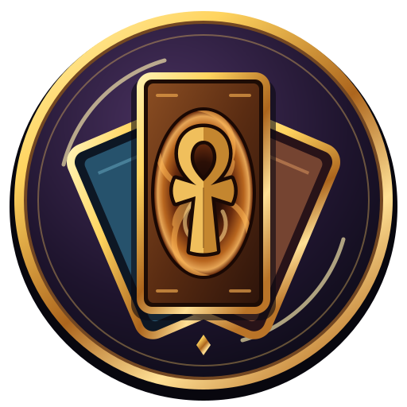

<p align="center">
  
</p>

# Yu-Gi-Oh! Power of Chaos Remake

**English** | [Español](README.es.md)

## Your ISO → PC or Android APK

Select your ISO images or installed game folders, then choose:

- **Extract for PC** to prepare the games for Windows.
- **Create APK** to build an Android APK with the Android branch's touch controls, scrolling and dragging. The APK and its validation receipt are saved **beside the launcher**. Already prepared games can also be reused.

**APK creation requires a local Android build setup:** Godot with Android templates, JDK, Android SDK, Android sources and your own signing key. These tools are not bundled in the EXE. [Android setup](#android-build-setup). PC extraction works with the standalone EXE.

The new buttons are available starting with **v0.1.0-alpha.3**. Your ISO images and converted resources stay on your computer; no original game data is included in the download. Physical Android device testing remains pending.

**Bring your Power of Chaos games together in one modern Windows launcher.**

## Why use it?

- **PC extraction or Android APK from the same launcher.** Reuse your compatible games and choose the output you need; APK creation requires the local Android build setup.
- **Joey network duels without DirectPlay.** Modern LAN networking replaces the legacy Windows component. Testing between two physical PCs is still pending.
- **Portable.** Keep the EXE and its **`PoC Data`** folder together: your resources, saves and settings travel with them.
- **Lighter game resources.** Lossless WebP images and OGG audio reduce storage; the tested Yugi library takes about **44% less space** than its uncompressed converted version. Savings vary by game and edition.
- **16:9 decorative side panels.** Widescreen decorations surround the original 4:3 duel area in the supported Yugi and Joey views. The current background images are temporary.
- **All three games in one place.** Yugi the Destiny, Kaiba the Revenge and Joey the Passion share one launcher. Import just one to start and add the others whenever you want.
- **Rendering above 30 FPS.** The renderer follows the display refresh rate, with interpolation between the original 30 Hz game ticks. Actual FPS depend on your PC and display; the original gameplay speed is preserved.

## What is this remake?

Yu-Gi-Oh! Power of Chaos Remake is an experimental Godot reimplementation of the engine behind **Yugi the Destiny, Kaiba the Revenge, and Joey the Passion**. It aims to preserve the original games' rules, presentation and feel while making them easier to launch and maintain on modern PCs.

You provide a compatible copy of the game you want to play. The launcher reads its resources locally and prepares them for the new engine. **One game is enough to get started.** You can add the other two later.

> **Early preview:** development and compatibility testing are ongoing. This is not a finished, fully faithful replacement for every original release.

### More launcher features

- **One launcher for three games.** Open an imported game by clicking its logo, or add another from the same menu.
- **One Windows executable.** The packaged launcher includes Godot, the local converter and 7-Zip. Players do not need to install those tools separately.
- **Start with the game you own.** Import Yugi, Kaiba or Joey independently; the other two are optional.
- **Use an ISO or an installed game folder.** Supported disc images are read as archives without running their installers or original game executables.
- **A portable game folder.** Resources, saves, preferences, conversion tools and temporary extraction files stay in **`PoC Data` beside the EXE**. Move the EXE and that folder together.
- **Smaller resource storage.** Images use pixel-exact lossless WebP when smaller; music and longer voices use OGG Vorbis. Very short effects remain WAV, as in the Android optimization process.
- **Keep your files local.** Your disc images, extracted resources and saved games are not uploaded to GitHub or a conversion service.
- **Add games without starting over.** Later imports preserve previously prepared games and existing remake saves.
- **Choose your language.** The launcher offers English, Spanish, German, French, Italian and Japanese, selects a supported system language on first use and remembers your preference.
- **A launcher made for this project.** Original launcher music, gold-accented controls, a custom application icon, volume settings and quick access to your games.
- **A maintainable engine.** Gameplay runs in Godot rather than by patching or launching the original Windows executables. Original resources are supplied separately by each player.

"Remake" refers to the engine reconstruction. It does not mean the original card illustrations, voices or music have been redrawn or re-recorded.

## Get started on Windows

1. Download **`PowerOfChaos.exe`** from [Releases](https://github.com/Johanfer12/Yu-Gi-Oh-Power-of-Chaos-Remake/releases) when a preview is available. Development builds are also available in [Actions](https://github.com/Johanfer12/Yu-Gi-Oh-Power-of-Chaos-Remake/actions/workflows/build-windows.yml).
2. Put the EXE in a folder where you want to keep the launcher and its saves, then open it.
3. In **ADD YOUR RESOURCES**, move over the game you want to add and choose **ISO** or **Folder**.
4. Select a compatible disc image or installed game folder, then click **Extract for PC** and wait for conversion to finish.
5. Click the prepared game's logo to play. The remaining games can be added later from the same screen.

The download is a single EXE; no installation wizard is required. The first import extracts and verifies the bundled conversion tools in `PoC Data/tools/`. Opening the menu does not wait for that extraction.

GitHub may package Actions artifacts in a ZIP. Release downloads expose the EXE directly.

### What you need

- A Windows PC capable of running Godot's OpenGL compatibility renderer.
- A compatible copy of at least one original game.
- Enough free disk space for the converted resources and temporary extraction files.

An installed game folder must contain `Data.dat`, `Voice.dat`, `Region.dat` and the corresponding original executable. The executable is read to obtain supported engine tables; it is not launched.

## How it works

```text
Your ISO or installed game folder
                |
       Local validation and extraction
                |
       Converted resources on your PC
                |
          Godot game engine
```

The distributed EXE contains the launcher, engine code and conversion tools. Original game binaries, card artwork, voices and in-game music are not distributed with it. They are read from the copy you select and converted locally.

Conversion works in a temporary directory inside `PoC Data`. It validates and compresses the new library before switching it into `PoC Data/resources/`. When adding a game, it uses the existing library as its base and retires the superseded generated copy after a successful switch. Original disc images, installed game folders and saves are not overwritten.

The importer validates supported executable profiles and rejects unsupported revisions. It also rejects damaged or truncated disc images. It does not download missing game resources.

### Where files are stored

| Files | Location relative to the EXE |
| --- | --- |
| Converted WebP/OGG resources and engine data | `PoC Data/resources/` |
| Remake saves | `PoC Data/saves/` |
| Launcher settings | `PoC Data/content.cfg` |
| Bundled conversion tools and licenses | `PoC Data/tools/` |
| Temporary extraction files | `PoC Data/temp/` and transient staging directories inside `PoC Data/` |
| Last import error report | `PoC Data/import-last-error.log` |

Keep **`PowerOfChaos.exe` and `PoC Data` together** when moving or backing up the game. The launcher uses relative resource paths, so moving the pair to another folder or drive does not require importing again. Choose a writable folder; if it is read-only, the launcher asks you to move it instead of silently storing games elsewhere.

When upgrading in the same folder, the launcher copies existing adjacent `saves/` into `PoC Data/saves/` without replacing newer portable saves. It also migrates the older application preferences and prepares a compact local copy of the previous imported library. Migration keeps the old source intact until the new library is verified. If upgrading to a different folder, copy your previous `saves/` beside the new EXE before its first run, or move an existing `PoC Data` folder with it.

## Compatibility and current limits

This preview targets **Windows PC**. Other platforms are not part of this release workflow.

The current development checks cover:

| Game | Import sources checked | Engine checks |
| --- | --- | --- |
| Yugi the Destiny | Compatible ISO and installed folder | Independent title and normal-duel startup |
| Kaiba the Revenge | Compatible ISO and installed folder | Independent title and normal-duel startup; supported executable profiles normalized without requiring Yugi |
| Joey the Passion | Compatible installed folder | Independent title and normal-duel startup |

A complete Joey ISO still needs end-to-end validation. A truncated image was correctly rejected. Support for other disc revisions and regional releases is still being expanded.

Gameplay, AI, presentation and timing are under active comparison with the originals. Passing these checks does not certify every duel or every card interaction. Please report the game, edition, import source and steps needed to reproduce a problem; do not attach original game files to issues.

Supported original MSI/CAB discs are extracted with bundled 7-Zip. Inno Setup media require `innoextract` on `PATH`; other unsupported installers should be installed separately before selecting their installed folder.

## Languages and voice packs

The language selector controls the launcher and the game's available text resources. Availability depends on the imported edition. `Data.dat` can differ between regions and revisions; the importer does not assume every release has identical data.

Voice packs are detected from the supplied `Voice.dat`. Switching language uses the matching installed dub when available, otherwise the primary imported dub remains in use. Selecting a language does not download its voices.

Additional voice packs from another compatible copy of the same game can be imported from the source tools:

```powershell
python -m pocx.import_games --base "existing-data" --voice "joey=C:\My Joey Copy\Voice.dat" --out "new-data"
```

Use a new output directory for manual imports. The launcher manages its own atomic in-place updates. Two different voice packs for the same game and language are rejected as a conflict rather than silently replacing one another.

## Run from source

Development requires **Godot 4.7.2** and **Python 3.12 or newer**. The Windows build workflow uses Python 3.13.

```powershell
git clone https://github.com/Johanfer12/Yu-Gi-Oh-Power-of-Chaos-Remake.git
cd Yu-Gi-Oh-Power-of-Chaos-Remake
python -m pip install ./tools
godot --editor --path game
```

Run `game/project.godot` from the editor. Start with an ISO or installed folder, just as in the packaged launcher. If Python is in a virtual environment, launch Godot from a shell with that environment activated.

Source-based imports need 7-Zip available through `PATH` or its usual Windows installation location. The distributed EXE already includes it and the audio encoder; FFmpeg is not needed for normal imports.

Synthetic importer checks do not require original game resources:

```powershell
$env:PYTHONPATH = "tools"
python -m unittest discover -s tools/tests -p "test_*import.py" -v
```

## Automatic Windows builds

[Launcher Windows](https://github.com/Johanfer12/Yu-Gi-Oh-Power-of-Chaos-Remake/actions/workflows/build-windows.yml) builds from the public sources:

- Pushes to `main` and pull requests generate a Windows build.
- The workflow can also be started manually.
- Tags beginning with `v` generate a GitHub prerelease containing the EXE, its SHA-256 checksum and a build manifest.

Each build checks the source file policy, runs synthetic importer tests, creates a clean export project, bundles the local converter and verifies the embedded tools. Game resources are not required by the build and are not included in it.

New downloads do not automatically update installed copies.

## Project status and notices

PoC Remake is an independent, unofficial project. It is not affiliated with or endorsed by the original games' publishers or rights holders. Game names identify compatible titles; their assets and trademarks remain with their respective owners.

The launcher theme, the two external duel backgrounds and the custom application icon belong to this project. The pending-game frames include vector outlines derived from the original logos; the original logo images are loaded only after importing a user's copy.

The source includes work derived through reverse engineering. Its provenance and project-wide licensing remain under review; no blanket license for the repository has been assigned. Publishing the sources does not license the original games or grant rights to redistribute their assets.

Third-party components retain their own licenses. See [THIRD_PARTY_NOTICES.md](THIRD_PARTY_NOTICES.md) and **Licenses** in the packaged launcher for the bundled engine and tool notices, including the matching 7-Zip source archive.

## Android build setup

APK creation is an optional local build flow for Windows. It needs Godot **4.7.2**
with its matching Android export templates, **Python 3.12+** for configuration, **JDK 21**, Android SDK/platform **35**
and build-tools **35.0.1**. In Godot's Editor Settings → Export → Android, set the
Java SDK and Android SDK paths. The SDK tools, templates and Java must be installed
on the computer doing the build; downloading the launcher alone does not install them.

Clone the [public Android source branch](https://github.com/Johanfer12/Yu-Gi-Oh-Power-of-Chaos-Remake/tree/android-tablet)
next to your main source checkout:

```powershell
git clone --branch android-tablet --single-branch https://github.com/Johanfer12/Yu-Gi-Oh-Power-of-Chaos-Remake.git ../PortTesting-Android
```

Create your own persistent **debug** signing key once, if you do not already have one:

```powershell
& "$env:JAVA_HOME/bin/keytool.exe" -genkeypair -keystore "C:/Tools/poc-debug.keystore" -storepass android -keypass android -alias androiddebugkey -keyalg RSA -keysize 2048 -validity 10000 -dname "CN=Power of Chaos local build"
```

From the main source checkout, configure the folder containing your downloaded EXE
(replace the example paths with your installed tools):

```powershell
python tools/configure_android_builder.py --launcher-dir "C:/Games/PoC" --android-root "../PortTesting-Android" --godot "C:/Tools/Godot/godot_console.exe" --sdk "C:/Tools/AndroidSdk" --java "C:/Tools/jdk-21" --keystore "C:/Tools/poc-debug.keystore"
```

This creates `android-builder.json` beside the EXE. For updates, add
`--previous-apk "C:/Games/PoC/your-previous.apk"` to check that the existing
certificate matches. Keep your key: a different key cannot update your installed app.
The first build verifies the output against your configured key without requiring
a previous APK. The project never distributes its private signing key.

Open the launcher, select your ISO/folders or use your prepared library, then click
**Create APK**. The dated APK and JSON receipt appear beside the EXE after signature,
16 KB alignment, bundled-data integrity and game-startup checks pass. Build logs
are kept in `PoC Data/android-builds/`; failures use `PoC Data/apk-last-error.log`.
The temporary data and export project are removed without changing your PC resources.
